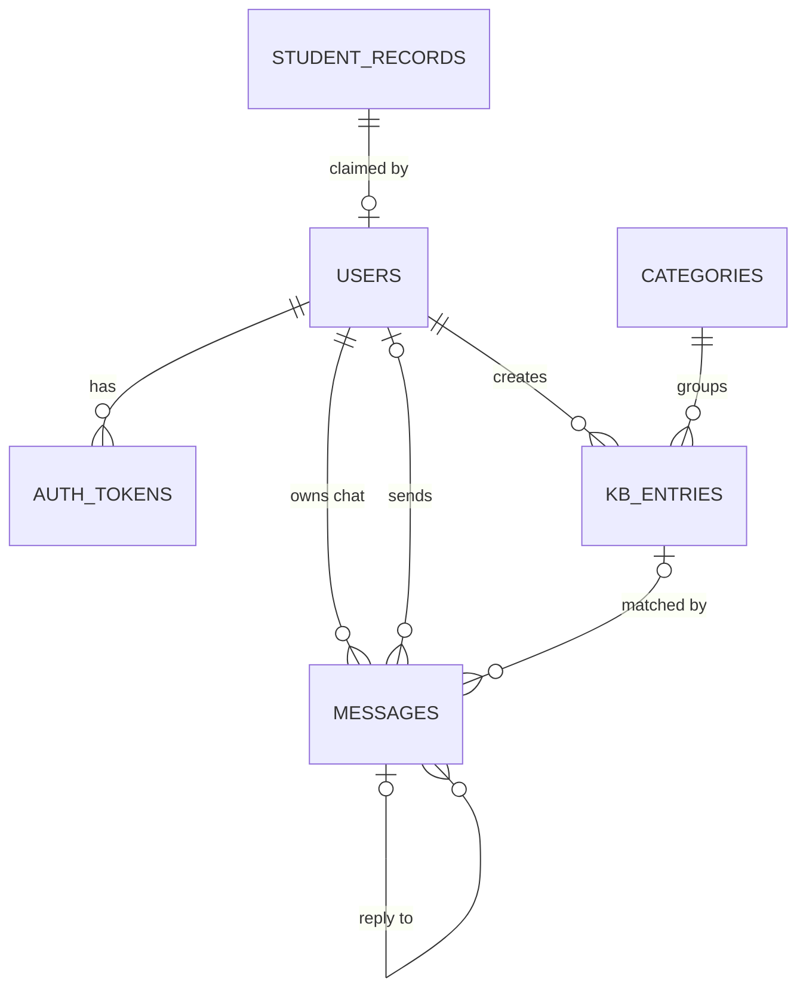

# University Admission Helpdesk

A chat helpdesk where students ask admission questions (GPA, fees, deadlines, documents, exams, halls) in **English or Banglish**. The system answers from an admin-managed knowledge base (KB). If it is not confident enough, the question goes to the admin, who replies in the same chat and can save the reply to the KB, so the next similar question gets answered automatically.

It runs fully offline: no external AI service and no API keys.

## Tech Stack

| Part | Used |
|---|---|
| Backend | Node.js, Express 5 |
| Database | PostgreSQL with Prisma ORM |
| Frontend | React 19, Vite, React Router 7, Axios |
| Auth | Random token stored as a SHA-256 hash in the database (not JWT), passwords hashed with bcryptjs |
| Matching | Built-in word embeddings + cosine similarity (no external API) |
| Testing | Jest, Supertest |

## How It Works

### 1. Registration and login
- Only students listed in the official **student records** can register. They need a matching roll number and registration number, and each record can be claimed once.
- Students log in with roll number + password. The admin logs in with email + password.
- On login the server creates a random token and stores only its hash, with an expiry time (`TOKEN_TTL_HOURS`, default 24). The frontend sends it as `Authorization: Bearer <token>`.
- Logging out, or the admin deactivating the user, stops the token from working right away.

### 2. Answering a question
1. A student sends a question. It is saved first with status `pending_admin`, so it is never lost.
2. The question is turned into a **vector of 4,096 numbers**. Stop words and Banglish filler words (`ki`, `ache`, `bhai`, ...) are dropped. Different spellings are mapped to one word (`porikkha`/`porikha` → `exam`, `fi` → `fee`, `hostel` → `hall`). Each remaining word is then hashed into a slot.
3. This vector is compared with every active KB entry using **cosine similarity**. KB vectors are stored in the database and cached in memory.
4. **Score ≥ `SIMILARITY_THRESHOLD` (0.4):** the best KB answer is sent back right away and the question is marked `answered`.
5. **Score below 0.4:** the question stays in the **admin inbox**, together with the closest KB entry so the admin can reuse its answer.
6. The admin replies, and can tick **"Save to KB"** so the reply becomes a new KB entry.
7. The student chat refreshes every 4 seconds to show admin replies.

### 3. Admin panel
- **Dashboard:** question and answer stats
- **Inbox:** reply to forwarded questions
- **Knowledge Base:** add, edit, delete and enable/disable entries. Changing the text re-embeds the entry.
- **Categories** and **Student Records:** manage both

The seed loads **14 categories and 1,014 KB entries** (14 English + 1,000 Banglish). All of it is demo data for a fictional university.

## Architecture

```
┌──────────────────────┐   HTTP + JSON    ┌──────────────────────────────────────────┐  Prisma  ┌────────────┐
│ React (Vite)         │ ───────────────► │ Express REST API                         │ ───────► │ PostgreSQL │
│ Student chat         │ Bearer token     │ routes → middleware → controllers →      │          └────────────┘
│ Admin panel          │ ◄─────────────── │ services (auth, chat, inbox, kb, stats,  │
└──────────────────────┘                  │ embedding + matcher = built-in AI)       │
                                          └──────────────────────────────────────────┘
```

| Layer | Responsibility |
|---|---|
| React client | Pages, forms, chat UI, role-protected routes. One axios instance adds the token to every request. |
| Routes | Map each URL to its middleware and controller |
| Middleware | `auth` (checks the token, sets `req.user`), `requireRole`, `validate`, `rateLimit`, central `errorHandler` |
| Controllers | Read the request, call a service, send JSON. No business logic. |
| Services | Business logic: registration transaction, question flow, embeddings, matching, inbox replies, stats |
| Database | PostgreSQL through Prisma. Queries are parameterised, with no hand-built SQL. |

## Project Structure

```
Admission Helpdesk/
├── backend/
│   ├── prisma/
│   │   ├── schema.prisma        Database models
│   │   ├── migrations/          SQL migrations
│   │   ├── seed.js              Creates admin, student records, categories, KB
│   │   ├── seedData.js
│   │   └── kb/                  KB data (facts, departments, units, places, lists, general)
│   ├── scripts/
│   │   ├── evaluate.js          Measures matching accuracy
│   │   └── reembed.js           Rebuilds all KB vectors
│   ├── src/
│   │   ├── server.js            Starts the server
│   │   ├── app.js               Express app and routes
│   │   ├── config.js            Reads .env
│   │   ├── routes/              auth, chat, admin
│   │   ├── controllers/         Handle requests and send JSON
│   │   ├── services/            Business logic (embedding, matcher, chat, inbox, kb, auth, token, stats, banglish)
│   │   ├── middleware/          auth, validate, rateLimit, errorHandler
│   │   ├── validators/          Input checks for each route
│   │   └── utils/
│   └── tests/                   Jest + Supertest tests
│
└── frontend/
    └── src/
        ├── api/client.js        Axios instance that adds the token
        ├── context/             AuthContext (logged-in user)
        ├── hooks/               usePolling
        ├── components/          ChatBubble, AdminLayout, ProtectedRoute, Modal, Toast, Loader
        └── pages/               Login, Register, StudentChat, AdminDashboard, AdminInbox,
                                 AdminKB, AdminCategories, AdminStudents
```

## Database



| Table | Purpose | Key fields |
|---|---|---|
| `student_records` | Official student list. Only these students can register. | `full_name`, `roll_no` (unique), `registration_no` (unique), `is_claimed` |
| `users` | Student and admin accounts | `student_record_id` (null for admin), `email` (admin only), `password_hash`, `role`, `is_active` |
| `auth_tokens` | Login sessions | `user_id`, `token_hash` (SHA-256), `expires_at` |
| `categories` | KB groups (Fees, Deadlines, ...) | `name` (unique) |
| `kb_entries` | Knowledge base | `category_id`, `created_by`, `question`, `answer`, `embedding` (JSONB, 4,096 numbers), `is_active` |
| `messages` | The whole chat | `student_id` (whose chat), `sender_id` (null for automatic answers), `sender_type` (student/ai/admin), `status` (answered/pending_admin), `matched_kb_id`, `similarity`, `reply_to_id` |

**Relationships**
- **student_records → users (1 : 0..1):** each record can be claimed by one account only.
- **users → auth_tokens (1 : N):** one row per login. The row is deleted on logout, and deleted along with its user.
- **categories → kb_entries (1 : N)** and **users (admin) → kb_entries (1 : N)**
- **users → messages (1 : N):** a student owns their chat.
- **kb_entries → messages (0..1 : N):** an automatic answer records the KB entry it came from. If that entry is deleted, the link is set to null.
- **messages → messages (0..1 : N):** an answer points to its question through `reply_to_id`.

Indexes: `messages (student_id, created_at)` to load a chat quickly, and `auth_tokens (user_id)`.

## API Details

Base URL: `http://localhost:5000/api`

Every response looks like `{ success: true, data }` or `{ success: false, message, errors? }`. Protected routes need the `Authorization: Bearer <token>` header.

### Auth

| Method | Endpoint | Access | Body | Description |
|---|---|---|---|---|
| POST | `/auth/register` | Public | `fullName, rollNo, registrationNo, password, confirmPassword` | Register a student |
| POST | `/auth/login` | Public | `type: "student"`, `rollNo, password` **or** `type: "admin"`, `email, password` | Log in and get a token |
| GET | `/auth/me` | Logged in | – | Current user |
| POST | `/auth/logout` | Logged in | – | Ends the session (revokes the token) |

### Chat (student only)

| Method | Endpoint | Body | Description |
|---|---|---|---|
| GET | `/chat` | – | Your chat history |
| POST | `/chat` | `content` (3–500 chars) | Ask a question. Returns an automatic answer, or marks the question as forwarded to the admin. |

### Admin (admin only)

| Method | Endpoint | Body | Description |
|---|---|---|---|
| GET | `/admin/student-records` | – | List student records |
| POST | `/admin/student-records` | `fullName, rollNo, registrationNo` | Add a record |
| PUT | `/admin/student-records/:id` | same as POST | Update a record |
| DELETE | `/admin/student-records/:id` | – | Delete a record (not allowed if already claimed) |
| GET | `/admin/categories` | – | List categories |
| POST | `/admin/categories` | `name` | Add a category |
| PUT | `/admin/categories/:id` | `name` | Rename a category |
| DELETE | `/admin/categories/:id` | – | Delete a category (not allowed if it still has entries) |
| GET | `/admin/kb` | – | List KB entries |
| POST | `/admin/kb` | `categoryId, question, answer, isActive?` | Add a KB entry |
| PUT | `/admin/kb/:id` | same as POST | Update a KB entry |
| DELETE | `/admin/kb/:id` | – | Delete a KB entry |
| GET | `/admin/inbox` | – | Questions waiting for an admin reply |
| POST | `/admin/inbox/:id/reply` | `content, saveToKb?, categoryId?, kbQuestion?` | Reply, and optionally save the reply to the KB |
| GET | `/admin/stats` | – | Dashboard stats |

**Rate limits:** register and login allow 10 requests per 15 minutes per IP. Chat allows 20 questions per minute per student.

**Status codes:** 200/201 OK, 400 validation error, 401 missing or invalid token, 403 wrong role, 404 not found, 409 conflict (for example, a record that is already claimed or a question that was already answered), 429 too many requests, 500 server error.

`password_hash` and `embedding` are never included in responses.

## Installation and Usage

### Requirements
- Node.js 20+
- PostgreSQL

### 1. Backend

```bash
cd backend
npm install
cp .env.example .env
```

Edit `backend/.env`:

| Variable | Meaning |
|---|---|
| `DATABASE_URL` | PostgreSQL connection string |
| `CLIENT_URL` | Frontend URL allowed by CORS (default `http://localhost:5173`) |
| `TOKEN_TTL_HOURS` | How long a login token stays valid (default 24) |
| `ADMIN_EMAIL`, `ADMIN_PASSWORD` | Admin account created by the seed (password needs at least 8 characters) |
| `SIMILARITY_THRESHOLD` | Minimum score needed to answer automatically (default 0.4) |

Then create the database and start the server:

```bash
npx prisma migrate dev    # creates the tables and seeds demo data
npm run dev               # http://localhost:5000
```

### 2. Frontend (in a second terminal)

```bash
cd frontend
npm install
npm run dev               # http://localhost:5173
```

In development, Vite forwards `/api` to the backend, so `frontend/.env` is only needed after deployment (`VITE_API_URL`).

### 3. Use it

Open http://localhost:5173 and log in with a demo account:

| Role | Login | Password |
|---|---|---|
| Admin | `admin@university.edu` | your `ADMIN_PASSWORD` |
| Student | roll `2001001` (Rahim Uddin) | `student123` |
| Student | roll `2001002` (Karima Akter) | `student123` |

To try registration, use an unclaimed record. For example: roll `2001003`, registration `9001003`.

Example questions to try: *"What is the application fee?"*, *"abedon fi koto taka?"*, *"CSE e koyta seat ache?"*

### Useful commands (run in `backend/`)

| Command | What it does |
|---|---|
| `npm run dev` | Starts the server with auto-reload |
| `npm start` | Starts the server |
| `npm test` | Runs the tests (uses a separate test database from `.env.test`) |
| `npm run db:seed` | Resets the demo data. **Deletes all existing data.** |
| `npm run reembed` | Rebuilds all KB vectors (run after changing the embedding or Banglish code) |
| `npm run evaluate` | Checks matching accuracy on 30 test questions |

## Known Limitations

- Answers are only as good and current as the KB. The seeded KB is demo data.
- The threshold (0.4) is hand-tuned on a small test set of 30 questions.
- The embeddings match shared words and known Banglish spellings, not meaning. New spellings or synonyms may fail until they are added to `banglish.js`.
- KB answers are returned exactly as written. They are not rephrased for the question.
- Each question is compared with every KB entry (about 90 ms for 1,000 entries). Entries are cached in memory, but a much larger KB would need a vector index such as pgvector.
- The chat uses polling, not websockets.
- The rate limiter is in memory, so it resets on restart and isn't shared between servers.
- The login token is stored in `localStorage`, so JavaScript on the page can read it.
